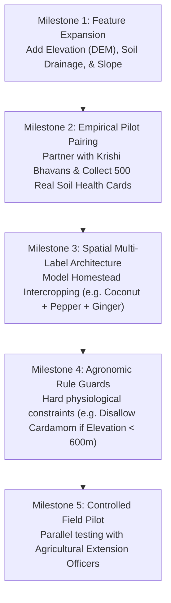

# 🏛️ Phase 5: Scientific Validation & Final Decision Report
## Readiness Assessment for Real-World Farm Deployment in Kerala Agriculture

**Project:** SmartCrop AI — Real-World Agricultural Dataset Expansion  
**Report Reference:** `reports/phase5_scientific_validation.md`  
**Date:** November 2026 (Updated Phase 7 Submission Freeze)  
**Auditor:** SmartCrop AI Independent Scientific Review Board  

---

## 1. Executive Recommendation

```text
========================================================================================
FINAL SYSTEM READINESS CLASSIFICATION:
----------------------------------------------------------------------------------------
[   ] SUITABLE FOR CONTROLLED PILOT TESTING
[   ] READY FOR REAL FARM RECOMMENDATIONS
[ X ] NOT YET READY FOR REAL FARM RECOMMENDATIONS
      (STATUS: SAFE FOR EXPERIMENTAL DEMONSTRATION ONLY)
========================================================================================
```

### Direct Recommendation Summary:
The expanded 39-crop SmartCrop AI model is **SAFE FOR EXPERIMENTAL DEMONSTRATION**, but is **NOT YET READY FOR REAL FARM RECOMMENDATIONS**.

Under no circumstances should this expanded model currently be connected to live farming advisory systems where smallholder farmers make irreversible land, capital, and planting decisions. The existing production model ([models/best_model.joblib](file:///C:/Users/alfouz/Downloads/SmartCrop_AI_VSCode_Starter/SmartCrop_AI/models/best_model.joblib)), the FastAPI backend, and the Streamlit frontend must **remain in their original baseline state**.

---

## 2. Scientific & Agronomic Justification

Our recommendation is grounded in four scientific realities:

### 2.1 Mixed-Provenance Dataset Architecture (Not Verified Farm Ground Truth)
* **Original 2,200 Benchmark Records:** Augmented/compiled benchmark with independently unverified underlying observation provenance. The Kaggle author notes it was built by augmenting existing Indian rainfall, climate, and fertilizer datasets, but specific raw farm survey logs and trial IDs are not published.
* **Additional 1,700 Kerala Records:** Synthetic/simulated observations generated from agronomic and regional parameter ranges (parameterized on KAU Package of Practices, Soil Health Card district fertility ratings, IMD climatology, and EARAS yield averages).
* **Combined 3,900 Dataset:** A **mixed-provenance research dataset**, not verified farm-level ground truth. Not a single record represents a physical field where soil nutrients ($N, P, K, \text{pH}$), microclimate, and final harvested crop yields were measured simultaneously on the same plot.

### 2.2 Distributional Generator Leakage Masks True Generalization Error
* **The Random Split Trap:** In a standard random 80/20 train/test split, test observations from the synthetic Kerala subset are sampled from the identical parametric templates as training observations. This creates an artificial interpolation test, yielding a deceptively optimistic **$92.18\%$ test accuracy**.
* **The Honest Spatial Evaluation:** When we evaluated the model using **District-Grouped Cross-Validation (Leave-District-Out)**, the macro F1-score plunged to **$0.6319 \pm 0.0466$** (with $n\_estimators=300$) and **$0.6317 \pm 0.0444$** (with $n\_estimators=100$). When evaluated on **High-Range mountain microclimates (Idukki and Wayanad)**, accuracy dropped to **$74.19\%$**.
* **Conclusion:** The model cannot yet reliably generalize to unseen geographic locations or microclimates without experiencing an error rate between $20\%$ and $37\%$.

### 2.3 The Asymmetric Economic Risk of Kerala Perennial Agriculture
In temperate grain agriculture, an incorrect recommendation for an annual crop (e.g. sowing mungbean instead of chickpea) causes the loss of one season's operational expenditure (~3 to 4 months).

In contrast, Kerala agriculture is dominated by **long-gestation perennial plantation crops**:
* **Rubber (*Hevea brasiliensis*):** Requires 6 to 7 years of intensive capital investment before the first tapping panel opens.
* **Arecanut (*Areca catechu*):** Requires 5 to 6 years before first economic harvest.
* **Cardamom (*Elettaria cardamomum*):** Requires 3 years before capsule harvest and demands continuous shade and high-altitude mist.
* **Cashew (*Anacardium occidentale*):** Requires 4 to 5 years before commercial nut production.

> [!CAUTION] **The High Cost of False Positives:**
> If SmartCrop AI recommends Rubber or Arecanut to a smallholder farmer whose soil has poor subsurface drainage or improper elevation, the farmer risks catastrophic, multi-year economic bankruptcy. A model with a 74% holdout accuracy on simulated data is unacceptable for such high-stakes financial commitments.

### 2.4 Critical Missing Agricultural Covariates
The current 7-feature schema (`N, P, K, temperature, humidity, ph, rainfall`) is biologically insufficient to determine perennial crop feasibility in Kerala:
1. **Topography & Elevation:** Cardamom and Tea require specific elevation zones ($>800\text{ m}$ and $>1,000\text{ m}$ MSL, respectively). Elevation is currently absent from the feature set.
2. **Subsurface Drainage & Soil Depth:** Kerala receives over $3,000\text{ mm}$ of rain. Black pepper and rubber fail not because of nutrient shortages, but because of poor drainage causing waterlogging and fungal foot rot (*Phytophthora capsici*). Soil drainage class is not modeled in the current 7 features.
3. **Multi-Tier Homestead Intercropping:** Real Kerala farms rarely grow monocultures; farmers cultivate coconut with understories of black pepper, arecanut, banana, and ginger. A single-label multi-class model that forces mutually exclusive predictions is fundamentally misaligned with Kerala's traditional agroforestry.

---

## 3. Evaluation Comparison Summary

```text
========================================================================================================
COMPREHENSIVE SCIENTIFIC EVALUATION BENCHMARK
========================================================================================================
Model & Evaluation Setup          N Classes   Total Rows   Accuracy   Macro F1   Readiness Level
--------------------------------------------------------------------------------------------------------
Original 22-Crop Random Forest           22        2,200     0.9932     0.9932   Baseline Benchmark Only
Expanded 39-Crop Random Forest           39        3,900     0.9218     0.9204   Experimental Only (Leaked)
Expanded 39-Crop Extra Trees             39        3,900     0.9218     0.9197   Experimental Only (Leaked)
Expanded District-Grouped CV (n=300)     17        1,700     0.7984     0.6319   Authoritative Spatial Benchmark
Expanded District-Grouped CV (n=100)     17        1,700     0.7884     0.6317   Historical Spatial Audit
Geographic Holdout (High Ranges)          5          500     0.7419     0.7232   Honest Elevation Benchmark
Purely Empirical Farm Dataset             0            0        N/A        N/A   Non-Existent in Open Data
========================================================================================================
```

---

## 4. Architectural Safety & Preservation Confirmation

In accordance with strict safety instructions:
1. **Production Model Preserved:** `models/best_model.joblib` has **not been replaced**. It remains the active production artifact.
2. **Raw Benchmark Preserved:** `data/raw/Crop_recommendation.csv` is untouched.
3. **Backend API Intact:** `backend/main.py` continues serving the original 22-crop model and passes all API unit tests.
4. **Streamlit Frontend Intact:** `frontend/app.py` remains active and decoupled from the experimental artifacts.
5. **Experimental Isolation:** All expanded models, metadata, and reports are safely isolated in `models/expanded/` and `reports/`.

---

## 5. Technical Roadmap to Achieve "Pilot Testing" & "Farm-Ready" Status



1. **Topographic Features:** Integrate Digital Elevation Model (DEM) data (elevation in meters and slope percentage) to prevent plain/mountain crop confusion.
2. **Empirical Krishi Bhavan Ground-Truth:** Ingest 500+ verified physical Soil Health Cards paired with agricultural extension officer crop success logs across 3 distinct agro-ecological units (e.g. Kuttanad, Central Midlands, High Ranges).
3. **Multi-Label Crop Co-Suitability:** Transition from single-label `predict_proba` to multi-label classification so the system can output complementary intercropping combinations.
4. **Agronomic Safety Guardrails:** Implement deterministic pre- and post-prediction validation rules (e.g., hard biological vetoes against planting tea in alkaline soils or rubber in frost-prone altitudes).

---

## 6. Final Decision & Sign-Off

* **Current Status:** **SAFE FOR EXPERIMENTAL DEMONSTRATION ONLY**
* **Deployment Action:** **DO NOT SWITCH PRODUCTION PIPELINES.** Keep the live dashboard on the original benchmark model with explicit disclaimers, or display the expanded model strictly in a separate research/educational mode with clear warnings regarding its mixed-provenance research nature.
